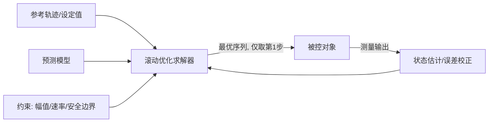
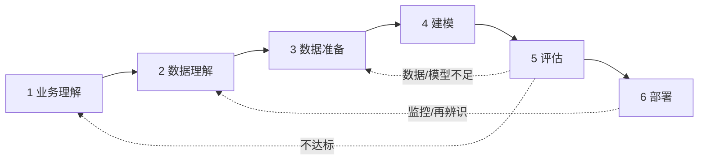
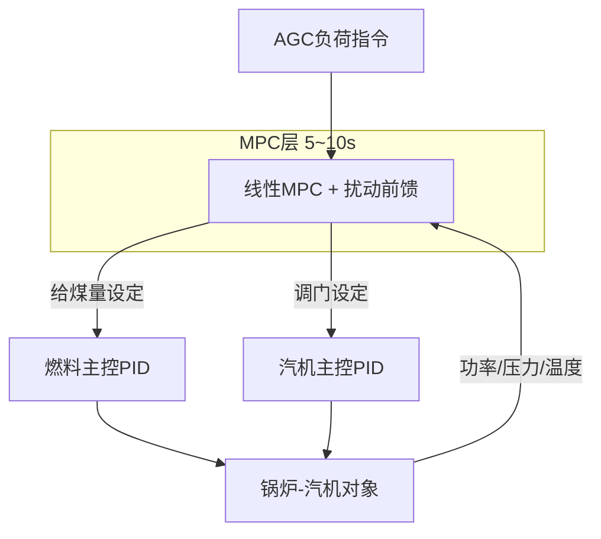

 MPC在工业制造与能源领域的应用：原理、场景与CRISP-DM实践

## 一、MPC原理

MPC是一种先进控制策略：利用数学模型预测系统未来状态，并优化控制输入以达成预设目标[1][4]。它广泛应用于工业生产过程[2][5]，也用于交通运输、航空航天等领域[3]。核心是**滚动时域优化**：

1. **预测模型**：用机理模型或数据驱动模型预测未来 N 步输出。
2. **滚动优化**：在约束下最小化代价函数，得到控制序列。
3. **反馈校正**：只执行第一步，下一周期用最新测量值重新求解，抵消模型误差与扰动。

标准形式（增量式）：

min Σ‖y(k+i)−r(k+i)‖²_Q + Σ‖Δu(k+i)‖²_R
s.t. 模型方程，u_min ≤ u ≤ u_max，Δu_min ≤ Δu ≤ Δu_max，y_min ≤ y ≤ y_max

## 二、优点与缺点

| 维度 | 优点 | 缺点 |
|---|---|---|
| 多变量 | 原生处理MIMO，自动协调回路耦合 | 维度增大后求解与维护成本上升 |
| 约束 | 显式处理执行器、工艺、安全约束 | 约束过紧可能无可行解，需软约束兜底 |
| 前瞻性 | 可利用未来设定值、已知扰动提前动作 | 依赖预测准确性 |
| 大滞后 | 对大惯性、大延迟对象效果显著 | 模型失配时性能下降 |
| 目标 | 兼顾精度、能耗、平滑性 | 权重整定依赖经验 |
| 实施 | 可作为上层，不必替换底层PID | 建模辨识成本高；实时算力要求高；非线性问题可能陷入局部最优 |

实际应用中的挑战主要集中在建模成本、实时求解和鲁棒性上[2][5]。

## 三、适用场景

MPC可处理非线性、多变量、时变系统[3]。判断是否适用可参考下表：

| 判据 | 适合MPC | 不必用MPC |
|---|---|---|
| 变量关系 | 多输入多输出、强耦合 | 单回路、弱耦合 |
| 动态特性 | 大滞后、大惯性 | 响应快且简单 |
| 约束 | 约束多，常在边界运行 | 约束宽松 |
| 经济性 | 卡边操作收益明显 | 收益有限 |
| 可测性 | 关键变量可测或可估计 | 缺关键测点 |
| 算力 | 采样周期远大于求解时间 | 微秒级回路（可考虑显式MPC） |

典型场景：

- **流程工业**：精馏塔、反应器、炼油装置的多变量协调与卡边操作。
- **离散与装备制造**：机床轨迹跟踪、机器人运动控制、AGV路径跟踪。
- **能源行业**：火电机组协调控制、锅炉燃烧优化、储能与微电网调度、冷热站优化。

## 四、CRISP-DM实践：火电机组深度调峰下的协调控制

### 阶段1：业务理解

**背景**：新能源渗透率提高后，燃煤机组频繁参与AGC调频与深度调峰。传统PID协调控制在变负荷时主汽压力波动大、负荷响应滞后。原因是锅炉制粉、燃烧、传热具有大惯性、大延迟，且汽机调门与给煤量强耦合。

| 任务 | 成果 |
|---|---|
| 确定业务目标 | 提升变负荷响应速度，降低主汽压力波动，降低过热器超温风险 |
| 评估形势 | 资源：DCS/SIS历史库、控制与工艺工程师、边缘服务器。约束：不得影响机组安全，MPC失效须无扰切回PID。风险：煤质波动、模型失配 |
| 确定数据挖掘目标 | 建立"给煤量、调门→实发功率、主汽压力、中间点温度"的预测模型，实现带约束滚动优化 |
| 成功标准（示例） | 负荷响应时间较PID缩短≥15%；主汽压力最大偏差下降≥20%；约束越限0次 |
| 项目计划 | 辨识试验→仿真验证→影子模式→分负荷段投运；列出工具与成本收益初估 |

### 阶段2：数据理解

| 任务 | 成果 |
|---|---|
| 收集初始数据 | 从SIS提取历史数据（采样1~5 s）及设备台账 |
| 描述数据 | MV：给煤量指令、调门指令；CV：实发功率、主汽压力、中间点温度；DV：AGC指令、煤质热值、给水流量 |
| 探索数据 | 变负荷段与稳态段占比；MV-CV相关性与延迟；煤质、磨煤机启停带来的时变特征 |
| 核查数据质量 | 缺失、冻结值、量程越界、激励不足 |

**结论**：稳态数据多、动态激励不足，需补做阶跃/PRBS试验。

### 阶段3：数据准备

| 任务 | 做法 |
|---|---|
| 选择数据 | 按负荷区间（如50%~100%）分段，保留变负荷与稳态样本 |
| 清洗数据 | 剔除坏点、冻结点；滤波降噪 |
| 构造数据 | 互相关估计纯延迟并对齐；计算增量 ΔMV；归一化为标幺值 |
| 整合数据 | 将DCS、SIS、化验煤质数据按时间戳合并 |
| 格式化数据 | 按时间划分训练/验证/测试集，避免信息泄漏 |

**成果物**：辨识数据集、数据字典、预处理脚本、数据选择与清洗记录。

### 阶段4：建模

| 任务 | 成果 |
|---|---|
| 选择建模技术 | 分负荷点线性模型（FOPDT传递函数矩阵或状态空间）+ 增益调度 + 扰动前馈；线性MPC（QP） |
| 生成测试设计 | 训练/验证分离；以验证集拟合度和闭环仿真为检验标准 |
| 构建模型 | 子空间辨识或最小二乘估计参数 |
| 评估模型 | 各负荷段拟合度、残差自相关、增益误差 |

**MPC设计（示例）**：

| 项目 | 设计 |
|---|---|
| 采样周期 | 5~10 s |
| 预测时域N | 覆盖主要调节时间 |
| 控制时域M | 5~10步 |
| 代价函数 | 功率与压力跟踪误差（Q）+ 控制增量（R） |
| 硬约束 | 给煤速率限制、调门开度范围 |
| 软约束 | 压力偏差带、中间点温度上限（加松弛变量保证可行） |
| 求解器 | OSQP、qpOASES |

MPC作为上层给出设定值，底层PID与DCS安全逻辑保持不变，便于回退。

**成果物**：辨识模型、MPC参数表、仿真工程、模型评估记录。

### 阶段5：评估

| 指标 | 目标（示例） | 方法 |
|---|---|---|
| 辨识精度 | 验证集拟合度≥85% | 测试集对比 |
| 负荷响应时间 | 较PID缩短≥15% | AGC曲线闭环仿真 |
| 主汽压力最大偏差 | 下降≥20% | 变负荷工况对比 |
| 约束越限 | 0次 | 全工况仿真 |
| 鲁棒性 | 增益±20%、延迟±20%失配下稳定 | 失配仿真 |
| 求解耗时 | 远小于采样周期 | 目标硬件实测 |

- **评估结果**：对照阶段1成功标准逐项判定，并折算AGC考核收益、煤耗与设备应力变化。
- **过程回顾**：检查激励试验是否覆盖工况、测点是否有遗漏。
- **下一步决策**：达标则进入试运行；不达标则回到阶段3补数据，或回到阶段1调整目标。

### 阶段6：部署

| 任务 | 方案 |
|---|---|
| 制定部署计划 | 边缘服务器运行，经OPC UA与DCS交互；先影子模式（只算不控），再单负荷段闭环，逐级放开 |
| 安全机制 | 输出限幅、变化率限制、通信看门狗、异常自动切回PID |
| 监控与维护计划 | 监控跟踪误差、约束触发率、模型残差、求解状态；残差持续超限或煤种变化、检修后触发再辨识 |
| 最终报告 | 技术方案、收益核算、运维手册、投退规程 |
| 项目回顾 | 总结经验教训，如激励试验设计、软约束权重、运行人员接受度 |

## 五、小结

MPC的价值在于"预测未来、显式约束、多变量协同"，尤其适合大滞后、强耦合、需卡边运行的工业对象。工程成败往往取决于模型质量、约束设计和安全回退机制。CRISP-DM把业务目标、数据、模型、评估和部署串成闭环，再通过监控与再辨识应对工况漂移。

## 参考链接

- [1] 工业自动化中的模型预测控制(MPC).pptx-原创力文档：https://max.book118.com/html/2024/0918/8067070005006127.shtm
- [2] 模型预测控制现状与挑战 - 豆丁网：https://www.docin.com/p-4529256231.html
- [3] 模型预测控制的应用研究 - 道客巴巴：https://www.doc88.com/p-74387289739001.html
- [4] 简单介绍MPC算法 - CSDN：https://m.blog.csdn.net/m0_52011717/article/details/138809680
- [5] 模型预测控制现状与挑战 - 人人文库：https://m.renrendoc.com/paper/293083888.html

- [1] QIN S J, BADGWELL T A. A survey of industrial model predictive control technology[J]. Control Engineering Practice, 2003, 11(7): 733-764.

- [2] RAWLINGS J B, MAYNE D Q, DIEHL M M. Model predictive control: theory, computation, and design[M]. 2nd ed. Madison, WI: Nob Hill Publishing, 2017.

- [3] CAMACHO E F, BORDONS C. Model predictive control[M]. 2nd ed. London: Springer, 2004.
